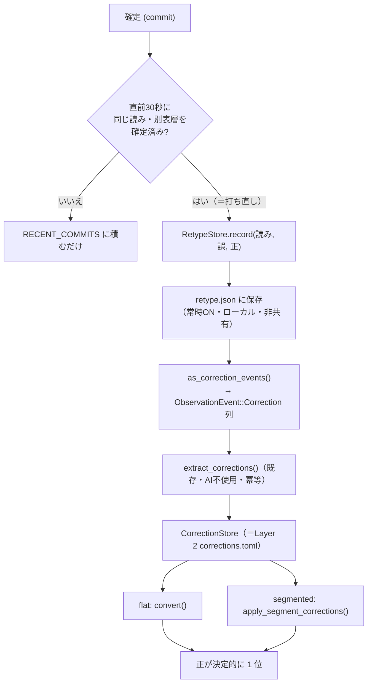

# 打ち直し訂正メカニズム (retype correction)

> 誤変換を「同じ読みで別の表層に打ち直す」瞬間を**常時ON**で捉え、打ち直した先（正）を
> 決定的に 1 位へ押し上げる仕組み。PR #211（2026-11-16）で実装、2026-11-17 に実機検証済み。
>
> このドキュメントは **(1) 共有** と **(2) ロジックの正しさを第三者が判定できる** ことを目的に、
> 各主張へ `file:line` の一次ソースを添えてある。思想の正本は
> [`LEARNING_ARCHITECTURE.md`](LEARNING_ARCHITECTURE.md)（この文書はその Layer 2 の具体メカニズム）。

## 1. 何を解いたか（問題）

森岡さん指摘（2026-11-15）:「変換が間違っていて後で打ち直すときが、学習の最大の機会でありかつ最大の苦痛。そこを把捉する方法はまだないよね？」

打ち直しの**検知**自体は以前から常時動いていた（`note_commit_detect_correction`、`nuko-macos/src/state.rs:439`）。
穴は**記録先**だった:

- 検知結果の `Correction` を、従来は **観察ログ（Layer 1, `observations.jsonl`）にしか記録していなかった**。
- 観察ログは**プライバシー配慮で opt-in・既定 OFF**（[`LEARNING_ARCHITECTURE.md` §1.5 / Layer 1](LEARNING_ARCHITECTURE.md)）。
- ⇒ **既定ユーザー（観察 OFF）では、打ち直しシグナルを丸ごと捨てていた。**

降格に必要な部品はすべて既にあった（下表）。**足りなかったのは「opt-in に依らず記録が届くこと」だけ**。

| 既にあった部品 | 出典 |
|---|---|
| 打ち直し検知（同読み・別表層・30秒窓） | `state.rs:439` / `controller.rs:1763` |
| `Correction` 1 件で選好化（weight 5 ≥ min_seen 2） | `correction.rs:190`,`208` |
| 訂正 bias が Layer0 頻度を上回る（300k > 200k） | `correction.rs:26`,`frequency.rs:113` |
| flat / segmented 両経路が `CorrectionStore` を消費 | `engine.rs`（`convert` / `apply_segment_corrections`） |

## 2. 全体のデータフロー



**要点: 新しい変換層を足していない。** 打ち直しを既存の `CorrectionStore` に**流し込むだけ**。
これにより (a) #178/#184 の「両経路に配線し忘れる」トラップを回避し、(b) `controller.rs`（IMK 境界）を
一切触らずに済む（＝実機 smoke のハードゲート外、低リスク）。

## 3. 各ステップの定義とゲート

### 3.1 検知（`note_commit_detect_correction`, `state.rs:439`）

「**同じ読み** を **別の表層** で **30秒以内** に確定し直した」ときだけ打ち直しと見なす。

- `RECENT_COMMITS`（揮発・thread_local, `state.rs:429`）に直近の `(読み, 表層, 時刻)` を保持。
- 条件 `r == reading && s != surface && t.elapsed() <= window`（`state.rs:447`）。
- 窓は `CORRECTION_WINDOW = 30s`（`controller.rs:1763`）。

### 3.2 記録（`RetypeStore::record`, `nuko-core/src/learning/retype.rs:104`）

記録しない条件（いずれか該当で `false`）:

| ゲート | 理由 |
|---|---|
| 読み・誤・正のどれかが空 | 無意味 |
| `正 == 読み` | かな素通りへの訂正は選好にしない（恒等は `extract_corrections` も弾く） |
| `正 == 誤` | 実際の打ち直しでない |

**supersede**（`retype.rs:111`）: 同じ読みで「以前 `prefer` にしていた表層」を今回 `avoid`（＝誤）として
打ち直したら、古いエントリを落とす。`A→B` の後に `B→C` と打ち直すと「読み→B」は消え「読み→C」だけが残る
（最新の意図が勝つ）。

保存先 `retype.json` は `phrase.rs` と同クラス＝**ローカル・非共有・churn-free（読み昇順で決定的）**
（`retype.rs:80`）。外部送信は一切しない（[§プライバシー境界](LEARNING_ARCHITECTURE.md)）。

### 3.3 畳み込み（`as_correction_events` → `extract_corrections`）

- `as_correction_events()`（`retype.rs:162`）が各エントリを `ObservationEvent::Correction` 1 件へ変換。
- **既存の** `extract_corrections()`（`correction.rs:208`）に食わせる。`Correction` 1 件は
  `CORRECTION_WEIGHT = 5`（`correction.rs:190`）を与え、既定 `min_seen = 2`（`state.rs:740`）を超えるので
  **1 回の打ち直しで選好化**される。
- 反映タイミング（`state.rs`）: 記録＝`note_commit_detect_correction` 内、反映＝`auto_relearn_after_commit`
  （観察 OFF でも打ち直しがあれば既存 corrections を尊重して upsert）/ `setup_corrections`（起動時畳み込み）/
  `relearn_now`（観察 ∪ 打ち直し）。「忘れる」（設定窓 + `nuko learn forget`）も `retype.json` を purge する
  （でないと次の確定で復活する）。

## 4. スコアの算術（なぜ「正」が決定的に勝つか）

変換候補スコア = `libakaza/辞書スコア` + `Layer0 頻度` + `Layer2 訂正 bias`
（[`LEARNING_ARCHITECTURE.md` §個人重みの合成](LEARNING_ARCHITECTURE.md)）。各項の定義:

| 項 | 式 | 出典 |
|---|---|---|
| Layer0 頻度 | `200_000 + count*10 − 時間減衰(最大30) + 追い越しboost` | `frequency.rs:112`-`131` |
| Layer2 訂正 bias | `300_000 + min(weight*10, 50_000)` | `correction.rs:145` |

**正**（打ち直し後）はその表層自身の Layer0 に加えて**訂正 bias（約 300,000）**を受け取る。
**誤**（打ち直し前）は Layer0 しか持たない。したがって（減衰・boost を無視した主要項で）:

```
score(正) ≈ (200_000 + count_正*10) + (300_000 + …)     ← 訂正 bias 込み
score(誤) ≈  200_000 + count_誤*10                        ← 頻度のみ
```

誤が正を上回るには `count_誤*10 > 300_000`、すなわち **誤を 30,000 回以上確定**していなければならない。
現実にはあり得ない。⇒ **1 回の打ち直しで、どれだけ高頻度な誤変換にも正が決定的に勝つ。**

## 5. 正しさを検証する方法（再現手順）

推測でなく実測で確かめる。`--explain` でスコア内訳を撮るのが定石（[§1.6 スコア透明化](LEARNING_ARCHITECTURE.md)）。

### 5.1 ユニットテスト（CI で常時）
```bash
cargo test --workspace --features akaza
```
核心テスト: `retype::tests::retype_feeds_decisive_correction_preference`（`retype.rs:254`）
— 打ち直し → Correction 列 → `extract_corrections` で **bias > 200_000** を assert（＝Layer0 に決定的に勝つ）。
他に record ゲート / supersede / forget / save-load の 7 本。

### 5.2 実機 runtime（CLI で順位を実測）
```bash
# install.sh は akaza 無しで nuko を上書きするので、先に akaza 付きで再ビルド
cargo build --release --features akaza -p nuko-cli
./target/release/nuko convert <読み> --libakaza --personal --explain
```

### 5.3 実機 smoke（IME 経由・end-to-end）
1. 入力ソースを切替→ぬこIME に戻す（新ビルドを有効化。[`CLAUDE.md` 実機 smoke test](../CLAUDE.md) 参照）。
2. ある読みを確定 → **30 秒以内**に同じ読みを別表層で確定（打ち直し）。
3. `~/Library/Application Support/nuko-ime/retype.json` にエントリが出る＝新記録経路が動いた証拠。
4. もう一度同じ読みを打つ → 打ち直した表層が 1 位。

### 5.4 検証エビデンス（2026-11-17・観察ログ ON 環境で実測）

`せいこう` を `成功` 確定 → 30 秒内に `精巧` へ打ち直し後、`nuko convert せいこう --libakaza --personal --explain`:

```
変換候補 (flat):
  1. 精巧 (せいこう) score=800380 [学習辞書] 学習×1   ← 打ち直し後（正）。たった1回
  2. 成功 (せいこう) score=200080 [学習辞書] 学習×8   ← 打ち直し前（誤）。8回確定済み
  3. 性交 (せいこう) score=98711  [libakaza/静的]
```

**誤（成功）は「学習×8」の高頻度語なのに、1 回打ち直した正（精巧・学習×1）が圧勝している。**
`成功 score=200080 = 200_000 + 8*10` が §4 の Layer0 式（`count*10`）を実証している。
正（精巧）の合成スコアの正確な内訳は環境依存なので、断定せず `--explain` で各自確認できる形にしてある。

## 6. 不変条件（将来の変更時に守ること）

1. **flat / segmented の両経路に配線する。** 片方だけだと「単体では学習が効くのに文中の語で永遠に勝てない」
   という再現しにくいバグになる（#178/#184 の教訓、[§個人重みの合成](LEARNING_ARCHITECTURE.md)）。
   本機構は「変換層を足さず既存 `CorrectionStore` に流す」ことでこれを**構造的に**満たしている。
2. **代替読み由来候補の学習キーは入力読みに付け替える。** 代替読みのままだと選んでも次回引けない
   （[[nuko-ime-romaji-nni-shinni]] / #159）。
3. **ローカル・非共有・churn-free。** `retype.json` は決定的に並べ替えて保存、外部送信しない。
4. **`controller.rs`（IMK 境界）を触らない。** 記録は既存の `note_commit_detect_correction` 内に相乗り。
   触った場合は実機 smoke 必須（[`CLAUDE.md`](../CLAUDE.md)）。

## 7. 既知の限界 / 残件

- **`×N`（打ち直し回数）のビューア表示 v2**。`retype.json` に `count` は溜めてあるので表示だけ。
- **文中の複数文節打ち直し**。現状は whole-reading 選好のため単文節（名前・同音異義）が主戦場。
- **count 拮抗の誤学習**。打ち直しが無い場合、`底(×28) > そこ(×27)` のような拮抗は `max` では覆らない
  （[§残件](LEARNING_ARCHITECTURE.md)）。打ち直しがあれば §4 の bias で覆る。

## 8. ソースマップ

| ファイル | 役割 |
|---|---|
| [`nuko-core/src/learning/retype.rs`](../nuko-core/src/learning/retype.rs) | `RetypeStore`・record/supersede/forget・`as_correction_events`・テスト |
| [`nuko-core/src/learning/correction.rs`](../nuko-core/src/learning/correction.rs) | `extract_corrections`・`CorrectionStore`・`upsert`・bias 算出 |
| [`nuko-macos/src/state.rs`](../nuko-macos/src/state.rs) | 検知・記録・`auto_relearn_after_commit`/`setup_corrections`/`relearn_now`・forget |
| [`nuko-macos/src/controller.rs`](../nuko-macos/src/controller.rs) | 30秒窓での検知呼び出し（IMK 境界・記録ロジックは持たない） |
| [`nuko-cli/src/main.rs`](../nuko-cli/src/main.rs) | `nuko convert --explain` / `nuko learn forget`（retype 畳み込み共用） |

**関連**: [`LEARNING_ARCHITECTURE.md`](LEARNING_ARCHITECTURE.md)（思想の正本） /
[`ARCHITECTURE.md` §3.4](ARCHITECTURE.md)（誤変換をどの層で直すか） / [`CLAUDE.md`](../CLAUDE.md)（運用規約）。
